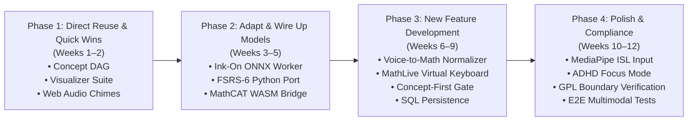

# Implementation Roadmap: 4-Phase Integration Plan

**Audit Date:** November 17, 2026  
**Auditor:** DeepMind Antigravity AI Engine  
**Execution Strategy:** Phased rollout prioritizing immediate reuse, architectural consolidation, clean-sheet engineering, and compliance hardening.

---

## Roadmap Timeline & Phase Overview

---

## Phase 1 — Direct Reuse of Existing Capabilities (Weeks 1–2)
*Goal: Rapidly integrate standalone assets, data structures, and zero-dependency visualizers that require no structural modifications.*

### 1.1 Complete MathLearn-Primary Visualizer Porting
- **Action**: Migrate the 18 missing canvas visualizers from `MathLearn-Primary` (`index.html` and `primary.html`) into modular React components under `frontend/src/components/visualizations/`:
  - Primary Visualizers: Fraction common denominator merger, parallelogram shear, circle quadrature limit proof, chicken-rabbit feet animation.
  - Secondary Visualizers: Number line rational operations, exponent block stacks, polynomial multiplication area tiles, Pythagorean 3-square dissection, radical simplification steps, trigonometric ratios, circle inscribed angles, probability experiments.
- **Deliverable**: `frontend/src/components/visualizations/suite/` containing all 22 interactive visualizers.
- **Acceptance Criteria**: Each visualizer mounts cleanly, binds to UMR initial parameters, and supports touch/mouse interaction with zero console errors.

### 1.2 Procedural Web Audio Sound Engine Integration
- **Action**: Extract the zero-dependency Web Audio API procedural synthesis code from `MathLearn-Primary` into a reusable frontend utility `frontend/src/utils/soundEffects.ts`.
- **Capabilities**: Synthesize subtle click tones, success chimes, balance equilibrium bells, and step completion alerts without external MP3 files.
- **Acceptance Criteria**: Instant, latency-free audio cues triggered during canvas drawing, slider adjustments, and step verification.

### 1.3 Full Concept Graph (DAG) Traversal Integration
- **Action**: Upgrade `MathAI/backend/src/orchestrator/adapters/mathua_adapter.py` to index all 4,818 concepts across all 25 domain JSON files in `Mathua/data/concepts/`.
- **Capabilities**: Implement depth-first topological sorting (`networkx` or native Python DAG traversal) to compute full prerequisite dependency chains from kindergarten to calculus.
- **Acceptance Criteria**: Querying any advanced concept (e.g. `alg.quad.solve_formula`) outputs an unbroken ordered chain of foundational sub-skills.

---

## Phase 2 — Adapt & Connect Partially Integrated Components (Weeks 3–5)
*Goal: Wire up existing models, compile native engines, and port core mathematical algorithms into the primary runtime.*

### 2.1 In-Browser ONNX Handwriting Inference Pipeline
- **Action**: Connect the existing CoMER INT8 models in `frontend/public/models/ink-on/comer/`:
  1. Add `onnxruntime-web` to `frontend/package.json`.
  2. Adapt `Ink-On/src/core/` into `frontend/src/workers/inference.worker.ts`.
  3. Integrate `preprocessing.ts`, `latex-repair.ts`, and `model-cache.ts` (IndexedDB caching).
  4. Connect `MathCanvas.tsx` stroke output directly to the local Web Worker.
- **Fallback**: Maintain the existing cloud Vision LLM route (`/api/recognize`) as a server-side fallback if the client device lacks WebAssembly SIMD or WebGPU support.
- **Acceptance Criteria**: Handwritten equations recognize in $<200\text{ ms}$ completely offline in the browser without network calls.

### 2.2 FSRS-6 Spaced Repetition Engine (Python Port)
- **Action**: Port the Free Spaced Repetition Scheduler v6 from `Mathua/internal/fsrs/` (`fsrs.go`, `curve.go`, `stability.go`, `difficulty.go`) into `backend/src/learning/fsrs.py`.
- **Capabilities**: Compute memory stability ($S$), difficulty ($D$), and retrievability ($R$) following each practice session attempt.
- **Acceptance Criteria**: Ported Python code matches Mathua's Go reference test vectors with $100\%$ numerical precision.

### 2.3 Official MathCAT WASM Integration
- **Action**: Replace the custom 207-line Python regex mock in `mathcat_adapter.py`:
  1. Compile DAISY's `MathCAT` Rust library to WebAssembly using `wasm-pack` with `rules-all` and `include-zip` features enabled.
  2. Embed the compiled WASM module in `frontend/src/a11y/mathcat/`.
  3. Expose official ClearSpeak speech, SimpleSpeak speech, Nemeth braille, and UEB technical braille generation.
  4. Enable hierarchical subexpression tree navigation (`do_navigate_keypress`).
- **Acceptance Criteria**: Mathematical expressions generate 100% compliant DAISY ClearSpeak audio strings and accurate 6-dot/8-dot Unicode braille.

---

## Phase 3 — Build Missing Capabilities & New Development (Weeks 6–9)
*Goal: Develop the critical pedagogical, cognitive, and structural features that do not exist in any upstream repository.*

### 3.1 Spoken Mathematics Grammar Normalizer
- **Action**: Develop a formal context-free grammar normalizer in `backend/src/voice/math_normalizer.py`.
- **Capabilities**: Transform natural acoustic phrasing (e.g. *"three x squared plus five x all over two"*) into standardized LaTeX (`\frac{3x^2 + 5x}{2}`).
- **Acceptance Criteria**: Unit test suite covering fractions, exponents, radicals, Greek variables, and trigonometry with $>95\%$ parsing success on conversational transcripts.

### 3.2 MathLive Virtual Equation Keyboard
- **Action**: Integrate `@cortex-js/mathlive` into `frontend/src/components/MathLiveEditor.tsx`.
- **Capabilities**: Provide an accessible on-screen virtual keyboard with dedicated buttons for mathematical templates ($\frac{\Box}{\Box}$, $\sqrt{\Box}$, $\Box^{\Box}$), symbols, and operators.
- **Acceptance Criteria**: Full two-way binding with the notebook's active UMR state, allowing instant manual correction of recognized handwriting.

### 3.3 Concept-First Mastery Gating System
- **Action**: Implement the pedagogical circuit breaker inside `backend/src/orchestrator/orchestrator.py`:
  1. When learning mode is active, intercept the solution payload before final steps are revealed.
  2. Extract the immediate prerequisite concept from the Mathua DAG.
  3. Generate a 10-second micro-challenge verifying prerequisite understanding.
  4. Reveal the full worked solution only after prerequisite confirmation.
- **Acceptance Criteria**: A student attempting a quadratic factoring problem must successfully identify factor pairs or the zero-product rule before viewing the complete solution.

### 3.4 Unified SQL Relational Persistence Layer
- **Action**: Replace ephemeral `localStorage` with a SQLite / PostgreSQL relational schema managed via SQLAlchemy in `backend/src/db/`:
  - Store student profiles, accessibility preferences, FSRS state vectors ($S, D, R$), and historical attempts with error tags.
- **Acceptance Criteria**: Student progress, mastery metrics, and spaced repetition schedules persist seamlessly across page reloads and devices.

### 3.5 Pedagogical Structural AST Verifier
- **Action**: Implement structural AST validation in `backend/src/solver/pedagogical_verifier.py`.
- **Capabilities**: Differentiate between algebraic equality ($\Delta = 0$) and pedagogical correctness (verifying whether expressions are factored, expanded, or isolated).
- **Acceptance Criteria**: Entering $x^2 - 9 = 0$ when prompted to factor $(x-3)(x+3) = 0$ is flagged as un-factored rather than marked correct.

---

## 4. Phase 4 — Polish, Accessibility Hardening & Compliance (Weeks 10–12)
*Goal: End-to-end integration, real-time input pipelines, neurodivergent accommodations, and legal compliance audits.*

### 4.1 Webcam Indian Sign Language Recognition Pipeline
- **Action**: Adapt `Sixth-Sense/js/recognition.js` into an isolated Web Worker:
  1. Integrate `@mediapipe/tasks-vision` `HolisticLandmarker` for real-time landmark tracking.
  2. Implement sliding-window Dynamic Time Warping (DTW) matching against `preset-references.json`.
  3. Output recognized mathematical operators directly into the notebook input stream.
- **Acceptance Criteria**: Webcam gesture input accurately recognizes signs for $+$, $-$, $\times$, $\div$, and digits with $<400\text{ ms}$ latency.

### 4.2 ADHD-Friendly Learning Accommodations
- **Action**: Build neurodivergent UI accommodations into `frontend/src/components/notebook/`:
  - Step-by-step progressive disclosure (revealing one step at a time).
  - Background visual focus spotlighting.
  - Dopamine audio micro-rewards and progress indicators.
  - Visual pacing countdown timer.
- **Acceptance Criteria**: Toggling `adhd_focus_mode` transforms the notebook into a simplified, step-by-step progressive interface.

### 4.3 GPL-3.0 Compliance & Legal Isolation Audit
- **Action**: Ensure legal compliance regarding `MAIDR` and `Sixth-Sense`:
  - Run `MAIDR` within a sandboxed `<iframe>` communicating solely via JSON `postMessage` calls to maintain clean-room MIT licensing for the host platform, OR formally re-license MathAI under GNU GPL v3.0 if full open-source distribution is chosen.
  - Add third-party attribution notices and license texts to `CREDITS.md` and the application `/about` dialog.
- **Acceptance Criteria**: Zero direct compilation contamination between MIT host code and copyleft GPL libraries.

### 4.4 End-to-End Multimodal Testing & Performance Benchmark
- **Action**: Execute end-to-end integration test suites across all modalities:
  - Handwriting $\to$ ONNX $\to$ SymPy $\to$ Visualizer $\to$ ClearSpeak $\to$ 3D ISL.
  - Performance validation: LCP $<2.0\text{ s}$, 60 FPS drawing loop, $<30\text{ MB}$ initial memory footprint.

