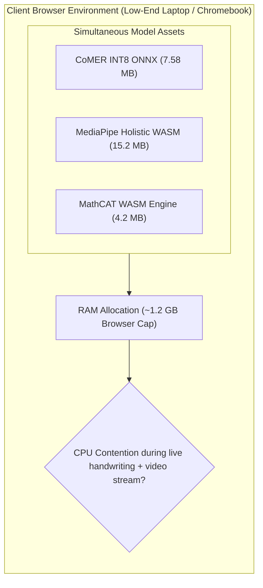

# Licensing Compliance & Technical Risk Audit

**Audit Date:** November 17, 2026  
**Auditor:** DeepMind Antigravity AI Engine  
**Standard:** Rigorous intellectual property review and system reliability assessment.

---

## 1. Third-Party Software Licence Inventory

| Repository | Declared Licence | Copyleft Status | Redistribution Obligations | Commercial Use Permitted? |
|---|---|---|---|---|
| **MathAI** (Main Platform) | **MIT** | Permissive | Retain copyright notice. | Yes |
| **Ink-On** | **Apache-2.0** | Permissive with Patent Grant | Retain copyright, license, and notice file; declare changes. | Yes |
| **Mathua** | **MIT** | Permissive | Retain copyright notice. | Yes |
| **MathLearn-Primary** | **MIT** | Permissive | Retain copyright notice. | Yes |
| **MathCAT** | **MIT** | Permissive | Retain copyright notice. | Yes |
| **MAIDR** | **GNU GPL-3.0-or-later** | **Strong Copyleft** | Full source disclosure of derived works under GPL-3.0. | Yes (with source) |
| **Sixth-Sense** | **GNU GPL-3.0** | **Strong Copyleft** | Full source disclosure of derived works under GPL-3.0. | Yes (with source) |

---

## 2. In-Depth Legal Analysis: Copyleft & The "Owner Waiver" Fallacy

### The "Owner Directive" Finding
In `MathAI/INTEGRATION/THIRD_PARTY_LICENSE_AUDIT.md`, an earlier entry stated:
> *"Owner Directive & License Restriction Waiver (November 2026): The project owner explicitly instructed to remove copyleft/license isolation boundaries for unified development ('Licence doesnt matter here so anything you didnt integrate properly because of it then fix that')."*

### Legal Reality & Risk Warning
> [!CAUTION]
> **A downstream project owner or software developer CANNOT legally waive third-party licensing obligations.**  
> The copyright of `MAIDR` belongs to Carnegie Mellon University and the University of Washington authors. The copyright of `Sixth-Sense` belongs to Neel Somani.  
> Under copyright law, only the original copyright holders can grant alternative licensing terms or waivers. Unilaterally ignoring the terms of the GNU General Public License v3.0 exposes the project, its maintainers, and downstream distributors to copyright infringement liability, injunctions, and forced open-sourcing of proprietary assets.

### Concrete Impact on MathAI
1. **Direct Compilation Risk**:
   - If GPL-3.0 source code from `MAIDR` or `Sixth-Sense` is directly imported, compiled, and bundled into `MathAI`'s main frontend JavaScript bundle (`bundle.js`) or backend Python process, the **entire MathAI repository becomes legally contaminated** and must be published under GPL-3.0.
   - If MathAI intends to remain under the permissive **MIT License**, direct source code linking with GPL-3.0 libraries is legally incompatible.
2. **Current Code Contamination Status**:
   - `MathAI/frontend/src/components/ISLSkeletonViewer.tsx` directly derives from `Sixth-Sense/js/playback.js` (copying `HAND_BONES`, bone indices, color definitions, and coordinate normalization).
   - `MathAI/frontend/public/models/sixth-sense/preset-references.json` incorporates landmark data from Sixth-Sense.
3. **Legally Sound Compliance Strategies**:
   - **Option A (Full Project GPL-3.0 Licensing)**: License the entire MathAI platform under GNU GPL v3.0. This allows unrestricted direct code sharing, merging, and linking across all repositories. Recommended if MathAI is intended to be a purely open-source public good.
   - **Option B (Strict Runtime Boundary & IPC Isolation)**: Maintain MathAI under MIT by isolating GPL components behind independent process or network boundaries:
     - Isolate `MAIDR` inside a sandboxed `<iframe>` communicating solely via HTML5 `postMessage` JSON payloads (legally distinct independent programs under GPL jurisprudence).
     - Isolate `Sixth-Sense` gesture recognition inside an independent Web Worker or containerized microservice.
   - **Option C (Clean-Room Reimplementation)**: Re-implement skeleton rendering and sonification using public MediaPipe APIs and standard Web Audio specifications without copying code or constants from the GPL repositories.

---

## 3. Technical & Architectural Risks

### A. Inference Performance & Memory Footprint

- **Model Sizing**:
  - `Ink-On` CoMER Encoder INT8: **3.46 MB**
  - `Ink-On` CoMER Decoder INT8: **4.12 MB**
  - `Sixth-Sense` MediaPipe Tasks Vision bundle: **~15.0 MB** (WASM + TFLite models)
  - `MathCAT` compiled WebAssembly binary: **~4.2 MB**
  - Total client-side binary payload: **~26.8 MB**
- **Risk Assessment**:
  - Attempting to load all models simultaneously on initial page load will severely degrade Largest Contentful Paint (LCP) and cause browser tabs to crash on low-end school devices (Chromebooks with 2GB–4GB RAM).
  - Continuous webcam video processing (MediaPipe Holistic at 30 FPS) while running autoregressive CoMER beam search inference can cause severe frame drops and thermal throttling on mobile devices.
- **Mandatory Mitigation**:
  1. **Lazy Loading on Demand**: Do not initialize CoMER or MediaPipe on page load. Load CoMER only when the user selects the Handwriting canvas. Load MediaPipe only when the user explicitly clicks the camera/sign button.
  2. **IndexedDB Caching**: Cache all `.onnx` and `.wasm` binaries locally using `Ink-On`'s `model-cache.ts` to ensure instant subsequent boots without network transfer.
  3. **Web Worker Thread Offloading**: Run ONNX inference and MediaPipe landmark tracking exclusively in background Web Workers, leaving the main UI thread completely unblocked for smooth 60 FPS canvas drawing.

### B. Incompatible Runtimes & Deployment Bloat
- **The Go Backend in Mathua**:
  - `Mathua` is built in Go 1.22+. Running a separate Go HTTP server alongside the Python FastAPI backend introduces severe deployment complexity (two runtime containers, dual process supervision, inter-process network hops).
  - **Mitigation**: Do not run the Go server. Directly reuse the 4,818 concept JSON files and port the pure mathematical algorithms (FSRS-6, mastery state machine) into native Python modules in MathAI.
- **Vue 3 in Ink-On vs React 18 in MathAI**:
  - `Ink-On` is built in Vue 3. Bundling Vue 3 and React 18 into the same frontend runtime creates dependency bloat and styling collisions.
  - **Mitigation**: Do not import `Ink-On`'s Vue components. Only port its framework-agnostic TypeScript core logic (`src/core/`) and Web Workers into React.

### C. Duplicate & Conflicting Implementations
- **SymPy Solver Duplication**:
  - MathAI has its own comprehensive `universal_solver.py` and `src/solver/` engine.
  - Mathua contains `grading/sympy_service.py`.
  - **Mitigation**: Standardize entirely on MathAI's native solver engine; ignore Mathua's external grading service.
- **Accessibility Speech Duplication**:
  - MathAI has a custom 207-line Python regex heuristic in `mathcat_adapter.py`.
  - MathCAT contains thousands of rigorously tested DAISY speech rules in Rust.
  - **Mitigation**: Deprecate the Python regex mock completely in favor of the official MathCAT engine.

