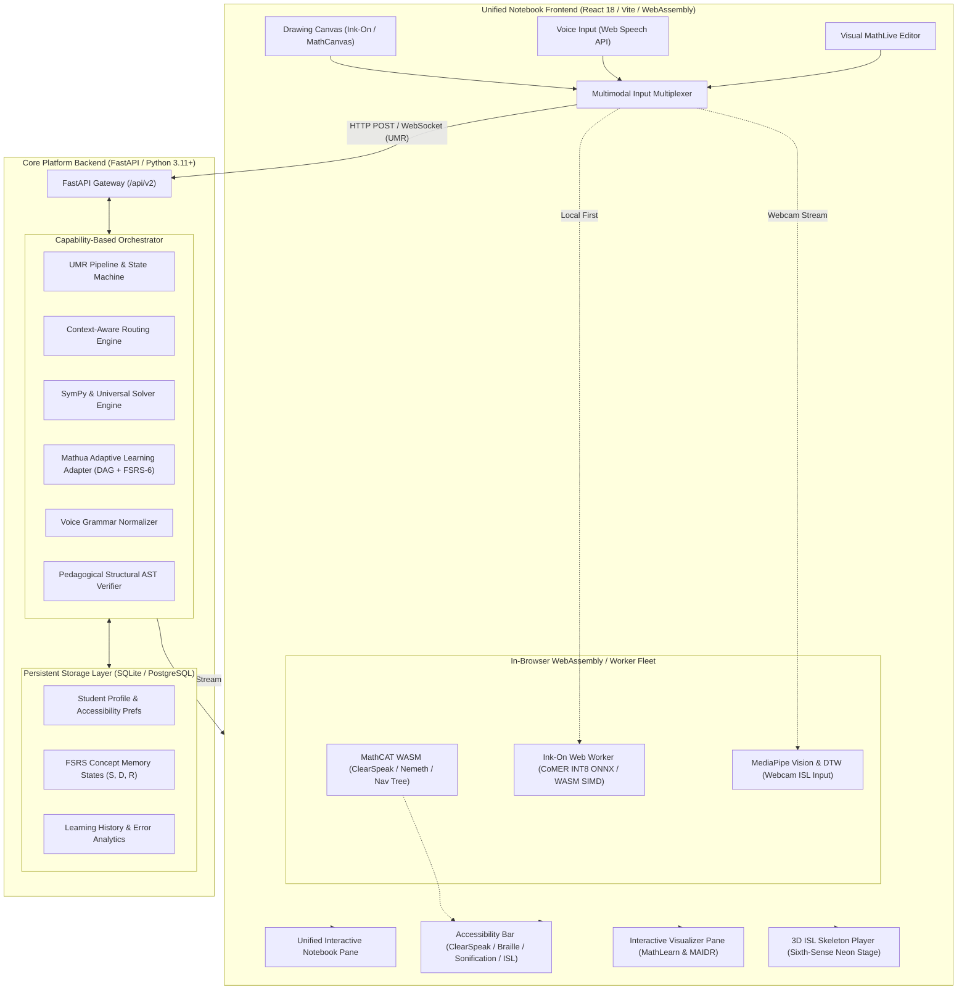

# Recommended Target Architecture & Unified UX/UI Blueprint

**Audit Date:** November 17, 2026  
**Auditor:** DeepMind Antigravity AI Engine  
**Vision:** One Unified Mathematical Notebook combining Multimodal Input, Concept-First Adaptive Learning, Interactive Visualisations, and Deep Accessibility.

---

## 1. Architectural Philosophy: The Unified Math Notebook

The central design goal is that **the student must never feel like they are switching between six disconnected applications**. 

Instead of opening separate tabs for handwriting, separate windows for 3D sign language, and separate tools for graphs, everything converges into **one living digital mathematical canvas**:
- **Multimodal Ingestion**: The student can draw, speak, or type into the same workspace seamlessly.
- **Unified Mathematical Representation (UMR)**: A shared AST and context payload passes through a central capability orchestrator.
- **Cohesive Multimodal Response**: A single problem submission simultaneously renders:
  1. Clear, pedagogical step-by-step explanations.
  2. Interactive geometric and algebraic manipulation widgets.
  3. Natural ClearSpeak audio narration and Nemeth/UEB braille displays.
  4. Web Audio pitch-mapped sonification for curves.
  5. Interactive 3D Indian Sign Language (ISL) skeleton demonstrations.
  6. Personalized adaptive prerequisite recommendations.

---

## 2. End-to-End System Architecture



---

## 3. Actionable UX/UI Notebook Blueprint

The notebook interface must feel calm, intuitive, and distraction-free, especially for young learners and students with ADHD.

### Notebook Interface Layout (Three-Column Responsive Grid)

```
+---------------------------------------------------------------------------------------------------+
|  [Logo] MathAI Notebook       Grade 8 Algebra       [Streak: 🔥 5] [Mastery: 84%]   [Profile/A11y] |
+---------------------------------------------------------------------------------------------------+
|  INPUT WORKSPACE (Top / Sticky)                                                                   |
|  [ Pen ] [ Eraser ] [ Shapes v ] [ Math Keyboard ] [ 🎙️ Voice ] [ 📷 Sign ]       [ Clear ] [ Solve ]|
|  +---------------------------------------------------------------------------------------------+  |
|  |  (Canvas Drawing Area: Freehand writing or geometric shapes)                                |  |
|  |  2x + 5 = 15                                                                                |  |
|  |  [Recognized: 2x + 5 = 15] (Ink-On Local ⚡ 140ms)                                          |  |
|  +---------------------------------------------------------------------------------------------+  |
+------------------------------------+------------------------------------+-------------------------+
|  COLUMN 1: PEDAGOGICAL NOTEBOOK    |  COLUMN 2: DYNAMIC VISUALIZER      |  COLUMN 3: ACCESSIBILITY|
|                                    |                                    |                         |
|  PREREQUISITE CHECK (Concept-First)|  [ Equation Balance Scale ]        |  [ ClearSpeak Speech ]  |
|  💡 Prerequisite: Inverse Ops      |                                    |  ▶️ "Two x plus five    |
|  "What is the inverse of +5?"      |       /\ [2x + 5]  =  [15] /\      |     equals fifteen"     |
|  [ -5 ]  [ +5 ]  [ /5 ]            |      /__\                 /__\     |                         |
|  (Verified! Solution unlocked)     |  Step Animation:                   |  [ Nemeth Braille ]     |
|                                    |  Subtract 5 from both pans:        |  ⠼⠃⠭⠬⠢⠀⠨⠐⠀⠼⠂⠢          |
|  STEP-BY-STEP SOLUTION (Chunked)   |       /\ [2x]      =  [10] /\      |  [Copy ASCII] [Download]|
|  Step 1: Isolate term with variable|      /__\                 /__\     |                         |
|  Subtract 5 from both sides:       |                                    |  [ Graph Sonification ] |
|  2x + 5 - 5 = 15 - 5               |  Interactive Controls:             |  🎵 Play Pitch Tone     |
|  2x = 10                           |  [ < Prev Step ]  [ Next Step > ]  |  (Frequency: 330 Hz)    |
|                                    |  [ Reset Scale ]  [ Auto-Play ]    |                         |
|  Step 2: Solve for x               |                                    |  [ 3D ISL Sign Player ] |
|  Divide both sides by 2:           |  Alternate Views:                  |  (Neon Skeleton Stage)  |
|  x = 5                             |  [ Balance Scale ] [ Number Line ] |  Active: "MINUS"        |
|                                    |                                    |  Layer 2 Action:        |
|  [ Verify My Next Step ]           |  Audio Feedback:                   |  "Subtract 5 both sides"|
|  Input: [___________] [Check]      |  🔔 Procedural chime on balance    |  [ ⏪ ] [ ⏸️ ] [ ⏩ ]    |
+------------------------------------+------------------------------------+-------------------------+
```

### Key Interactive UX Design Rules:
1. **Never Clear Canvas on Solve**: The student's drawing or writing stays visible on the left side of the canvas with a non-destructive recognized LaTeX overlay so they can see exactly how the AI parsed their handwriting.
2. **Synchronized Multimodal Playback**: When the student presses *"Play Step 1"*, the platform simultaneously:
   - Speaks the explanation using MathCAT ClearSpeak.
   - Highlights the balance beam subtracting 5 weights in the visualizer.
   - Plays the procedural audio chime for the operation.
   - Animates the 3D ISL skeleton performing the "MINUS" and "5" transformation signs.
3. **ADHD Progressive Chunking**: By default, only the active step is highlighted; subsequent steps are hidden behind a gentle *"Reveal Next Step"* interaction to eliminate visual clutter.
4. **Immediate Error Recovery (Not Error Prompts)**: If drawing is ambiguous, never throw a red error box. Present a friendly inline clarification: *"Did you mean $x^2$ or $2x$?"* with one-click tap chips.

---

## 4. Component Fate Classification

To prevent architectural thrash and avoid unnecessary rewrites, every component is assigned an explicit operational fate:

| Component | Source / Location | Operational Fate | Strategic Rationale |
|---|---|---|---|
| **FastAPI Orchestrator Core** | `MathAI/backend/src/orchestrator/` | **Remain Unchanged** | Already implements clean pipeline orchestration, capability registration, and UMR data contracts. |
| **SymPy & Universal Solver** | `MathAI/backend/src/solver/`, `universal_solver.py` | **Remain Unchanged** | Highly complete symbolic math engine covering algebra, calculus, geometry, and mensuration. |
| **3D Neon ISL Skeleton Player** | `Sixth-Sense/js/playback.js` $\to$ `MathAI/ISLSkeletonViewer.tsx` | **Remain Unchanged** | Seamlessly ported to React with neon bones, face contours, and coordinate scaling. |
| **Equation Balance Scale Visualizer** | `MathLearn-Primary` $\to$ `MathAI/EquationBalanceVisualizer.tsx` | **Remain Unchanged** | Excellent interactive balance demonstration directly mapped to linear equation steps. |
| **Mathua Concept Graph DAG** | `Mathua/data/concepts/*.json` | **Directly Reused** | 4,818 concept nodes across 25 domains reused as the core curriculum ontology. |
| **Sixth-Sense Landmark Presets** | `Sixth-Sense/data/preset-references.json` | **Directly Reused** | 106 gesture presets reused for 3D skeleton keyframe rendering. |
| **CoMER INT8 ONNX Models** | `Ink-On/public/models/comer/` | **Directly Reused** | Quantized 7.6 MB models reused for on-device browser inference. |
| **Procedural Web Audio Synthesizer** | `MathLearn-Primary/index.html` | **Directly Reused** | Zero-dependency Web Audio API procedural sound synthesis reused for instant UI audio cues. |
| **Ink-On In-Browser Inference Pipeline** | `Ink-On/src/core/` | **Adapted** | Adapt Vue/Vite TypeScript inference pipeline and Web Worker into React/Vite worker infrastructure. |
| **MathLearn-Primary Visualizer Suite** | `MathLearn-Primary/index.html`, `primary.html` | **Adapted** | Adapt 18 remaining canvas visualizers (dissections, Pythagorean proof, fractions) into React visualizer tabs. |
| **Mathua Spaced Repetition (FSRS-6)** | `Mathua/internal/fsrs/` | **Adapted** | Port FSRS-6 algorithm from Go into Python backend service `backend/src/learning/fsrs.py`. |
| **Sixth-Sense MediaPipe DTW Recognition** | `Sixth-Sense/js/recognition.js` | **Adapted** | Adapt webcam capture and sliding-window DTW gesture recognition into a client-side Web Worker. |
| **MathAI Python MathCAT Adapter** | `MathAI/backend/.../mathcat_adapter.py` | **Replaced** | Replace the 207-line custom regex/dictionary mock with the official `MathCAT` Rust library compiled to WASM. |
| **MathAI Static MAIDR Adapter** | `MathAI/backend/.../maidr_adapter.py` | **Replaced** | Replace static 21-point parabola generator with a true dynamic Web Audio sonification engine supporting any curve. |
| **Spoken Mathematics Grammar Normalizer** | *None* (New) | **Newly Developed** | Context-free grammar transformer converting spoken mathematical phrasing into standardized LaTeX. |
| **MathLive Virtual Math Keyboard** | *None* (New) | **Newly Developed** | Virtual on-screen structured formula keyboard integrated into the notebook header. |
| **Concept-First Mastery Gating Engine** | *None* (New) | **Newly Developed** | Active pedagogical interceptor that challenges prerequisite understanding before revealing solutions. |
| **Unified Student Progress SQL Database** | *None* (New) | **Newly Developed** | SQLAlchemy / SQLite relational database persisting student mastery, FSRS memory states, and attempts. |
| **Pedagogical Structural AST Verifier** | *None* (New) | **Newly Developed** | Evaluates mathematical expression tree structure to verify whether students performed requested operations. |

