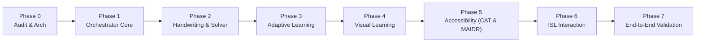

# MathAI Master Integration Plan & Phased Implementation Roadmap

**Project:** MathAI — Universal Inclusive Mathematics Platform  
**Target:** Production-Grade Unified Architecture  

---

## Roadmap Overview

---

## Phase Breakdown & Deliverables

### Phase 0: Repository Audit & Compliance (COMPLETE)
- [x] Inspect all 7 repository directories.
- [x] License compliance audit (`INTEGRATION/THIRD_PARTY_LICENSE_AUDIT.md`).
- [x] Capability matrix & overlap analysis (`INTEGRATION/architecture/CAPABILITY_MATRIX.md`).
- [x] Orchestration system architecture document (`INTEGRATION/architecture/SYSTEM_ARCHITECTURE.md`).
- [x] Master integration plan (`INTEGRATION/architecture/INTEGRATION_PLAN.md`).
- [x] Initialize progress tracking (`INTEGRATION/PROGRESS.md`).

---

### Phase 1: Central Orchestration Engine & UMR Schemas
- **Target Location:** `MathAI/backend/src/orchestrator/`
- **Deliverables:**
  1. `schemas/umr.py`: Pydantic v2 data models for the Unified Mathematical Representation.
  2. `schemas/profile.py`: Student learning and accessibility preferences profile.
  3. `capability_registry.py`: Dynamic registry tracking availability, health, and fallbacks.
  4. `workflow_manager.py`: Master workflow executor coordinating the 8-step pipeline.
  5. `routing_engine.py`: Profile-aware adapter selection.
  6. Base adapter definitions (`adapters/base.py`).
  7. API endpoint `/api/orchestrate/process` wired into FastAPI.
- **Verification:** Unit tests verifying UMR serialization, capability health checks, and profile routing.

---

### Phase 2: Handwriting & Solver Pipeline Integration
- **Target:** Unify Ink-On client-side ONNX engine with MathAI's SymPy solver and Vision fallback.
- **Deliverables:**
  1. `adapters/handwriting_adapter.py`: Coordinates client-side Ink-On candidates and Vision OCR fallback.
  2. `adapters/solver_adapter.py`: Connects MathAI's SymPy CAS, step equivalence verification, and explanation enrichment to UMR.
  3. Client-side integration of Ink-On ONNX inference engine into `MathAI/frontend`.
  4. Benchmark test comparing Ink-On recognition with Vision OCR on representative expressions ($x^2 + 5x + 6 = 0$, $3x - 7 = 11$, $\frac{x+1}{2} = 3$).
- **Verification:** Both handwriting and typed equations correctly flow from input to verified SymPy solution.

---

### Phase 3: Adaptive Learning (Mathua Integration)
- **Target:** Connect Mathua's concept dependency DAG to provide prerequisite learning.
- **Deliverables:**
  1. `adapters/mathua_adapter.py`: Ingests `Mathua/data/concepts/*.json` and `mastery_units.json`.
  2. Prerequisite concept resolver: Maps equation topics (e.g. quadratic equations) to required prior knowledge (variables, coefficients, factoring, zero-product property).
  3. Frontend concept learning tray: Displays missing/prerequisite concepts before or alongside the solution.
- **Verification:** $x^2 + 5x + 6 = 0$ returns ordered prerequisites (`prealg.expr.variables`, `alg.factor.trinomial`, `alg.quad.zero_product`).

---

### Phase 4: Interactive Visual Learning (MathLearn-Primary Extraction)
- **Target:** Integrate interactive mathematical models into MathAI's solution view.
- **Deliverables:**
  1. React port of **Equation Balance** (interactive scale for linear equation solving).
  2. React port of **Quadratic Parabola & Roots** (dynamic slider for $a, b, c$, discriminant $\Delta$, and x-intercepts).
  3. React port of **Algebra Tiles / Complete Square** (area model visualization).
  4. Dynamic linking: When the solved problem is quadratic or linear, provide a "Visual Explanation" tab.
- **Verification:** User can interact with sliders and scale directly in the MathAI workspace.

---

### Phase 5: Accessibility Layer (MathCAT Speech & Braille + MAIDR)
- **Target:** Comprehensive access for blind and low-vision learners.
- **Deliverables:**
  1. `adapters/mathcat_adapter.py`: Converts AST / LaTeX / MathML into ClearSpeak speech strings and Nemeth/UEB Braille codes.
  2. `adapters/maidr_adapter.py`: Generates sonification frequency sequences and spatial keyboard navigation metadata for plots and graphs.
  3. Frontend Accessibility Controls: Screen reader spoken descriptions, audio sonification player, and Braille display toggle.
- **Verification:** Tested against screen reader accessible markup and Nemeth code generation.

---

### Phase 6: Indian Sign Language (Sixth-Sense Integration)
- **Target:** Gesture-based digit/variable input and sign animations for supported vocabulary.
- **Deliverables:**
  1. `adapters/sixth_sense_adapter.py`: Template matcher and sign vocabulary validator.
  2. ISL input modal for recognized signs (digits 0-9, variables x, y, basic commands).
  3. Honest limitation warnings: Clearly flags unsupported expressions rather than fabricating signs.
- **Verification:** Tested gesture input for supported signs with fallback to typed/handwriting.

---

### Phase 7: End-to-End Testing, Validation & UI Polish
- **Target:** Full end-to-end user scenario validation.
- **Deliverables:**
  1. Full execution of the canonical test scenario: $x^2 + 5x + 6 = 0 \to (x+2)(x+3)=0 \to x = -2 \text{ or } -3$.
  2. Multi-preference testing (visual learner, blind learner, deaf learner, focused one-step learner).
  3. Regression test suite validation.
  4. Final documentation in `INTEGRATION/PROGRESS.md`.

