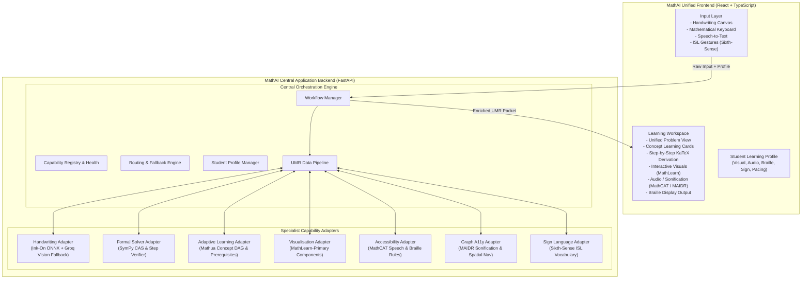
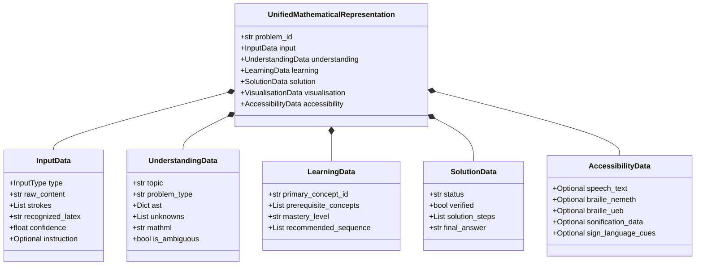

# MathAI System Architecture & Orchestration Specification

**Project:** MathAI — Universal Inclusive Mathematics Learning Platform  
**Version:** 2.0  
**Status:** Architecture Blueprint  

---

## 1. Architectural Vision & Central Principle

> **ONE MATHEMATICAL PROBLEM.**  
> **ONE VERIFIED MATHEMATICAL SOLUTION.**  
> **MULTIPLE WAYS OF UNDERSTANDING THAT SOLUTION.**

The platform unifies 7 distinct capabilities into a single seamless learning environment. Students never experience disconnected silos. The central orchestrator coordinates specialist adapters according to the student's dynamic profile and accessibility needs.

---

## 2. System Architecture Diagram



---

## 3. The Unified Mathematical Representation (UMR)

To eliminate brittle string-passing and impedance mismatches across independent components, all subsystems communicate via the **Unified Mathematical Representation (UMR)**:



### JSON Schema Specification (Illustrative)
```json
{
  "problem_id": "prob_9823fbc1",
  "input": {
    "type": "handwriting",
    "raw_content": "canvas_stroke_data",
    "recognized_latex": "x^2 + 5x + 6 = 0",
    "confidence": 0.98,
    "provider": "ink_on"
  },
  "understanding": {
    "topic": "quadratic_equations",
    "problem_type": "factorisation",
    "ast": { "type": "eq", "left": { ... }, "right": 0 },
    "unknowns": ["x"],
    "mathml": "<math xmlns='http://www.w3.org/1998/Math/MathML'>...</math>",
    "is_ambiguous": false
  },
  "learning": {
    "primary_concept_id": "alg.quad.solve_factor",
    "prerequisite_concepts": [
      { "id": "prealg.expr.variables", "label": "Variables and Constants" },
      { "id": "alg.factor.trinomial", "label": "Factoring Trinomials" },
      { "id": "alg.quad.zero_product", "label": "Zero-Product Property" }
    ],
    "mastery_status": "in_progress"
  },
  "solution": {
    "status": "solved",
    "verified": true,
    "steps": [
      {
        "step_number": 1,
        "latex": "(x + 2)(x + 3) = 0",
        "operation": "factor_quadratic",
        "verified": true,
        "explanation": "Factor the quadratic expression by finding two numbers that multiply to 6 and add to 5 (2 and 3)."
      },
      {
        "step_number": 2,
        "latex": "x + 2 = 0 \\quad\\text{or}\\quad x + 3 = 0",
        "operation": "zero_product_property",
        "verified": true,
        "explanation": "Apply the zero-product property: if a product is zero, at least one factor must be zero."
      },
      {
        "step_number": 3,
        "latex": "x = -2 \\quad\\text{or}\\quad x = -3",
        "operation": "solve_linear_subequations",
        "verified": true,
        "explanation": "Solve each simple linear equation to find the two roots."
      }
    ]
  },
  "accessibility": {
    "speech": {
      "clearspeak": "x squared plus five x plus six equals zero",
      "steps_speech": [
        "Step 1: Factor the equation into the quantity x plus two times the quantity x plus three equals zero.",
        "Step 2: Set each factor equal to zero: x plus two equals zero or x plus three equals zero.",
        "Step 3: Solve each equation to get x equals negative two or x equals negative three."
      ]
    },
    "braille": {
      "nemeth": "⠭⠘⠆⠐⠬⠢⠭⠬⠖⠀⠨⠤⠀⠴",
      "ueb": "⠭⠔⠼⠃⠐⠖⠼⠑⠭⠐⠖⠼⠋⠀⠐⠶⠀⠼⠚"
    },
    "sonification": null,
    "sign_language": {
      "supported": true,
      "available_tokens": ["X", "2", "5", "6", "0"]
    }
  }
}
```

---

## 4. Student Learning Profile

Preferences are user-configurable accommodations, never rigid disability labels:

```json
{
  "student_id": "student_default",
  "preferences": {
    "learning_style": "visual",
    "steps_per_screen": 1,
    "explanation_depth": "detailed",
    "show_prerequisites_first": true,
    "speech_enabled": false,
    "speech_rate": 1.0,
    "braille_enabled": false,
    "braille_standard": "nemeth",
    "sign_language_enabled": false,
    "sign_language_dialect": "ISL",
    "interactive_visuals_enabled": true,
    "sonification_enabled": false,
    "reduced_distraction": false,
    "high_contrast": false
  }
}
```

---

## 5. End-to-End 8-Step Pipeline

1. **Step 1: Multi-Modal Input**  
   User enters problem via handwriting (Canvas), mathematical keyboard, voice transcription, or supported ISL gestures.
2. **Step 2: Dual-Engine Recognition**  
   - Expression handwriting uses Ink-On client-side ONNX engine for immediate, private, rate-limit-free recognition.
   - Word problems or low-confidence sketches seamlessly fall back to Vision OCR.
3. **Step 3: Mathematical Understanding & AST**  
   - The expression is parsed into a structured AST via SymPy.
   - Topic and unknowns are extracted.
   - Ambiguous strokes trigger explicit clarification rather than silent guesses.
4. **Step 4: Adaptive Learning Analysis**  
   - Mathua adapter inspects the concept DAG.
   - Prerequisites are identified and attached to the UMR packet.
5. **Step 5: Rigorous Formal Solving**  
   - MathAI SymPy engine generates ordered solution steps.
   - Every single transformation undergoes formal equivalence verification.
   - Verification status is stamped onto every step.
6. **Step 6: Pedagogical Teaching & Hint Ladder**  
   - Contextual "what" and "why" pedagogical explanations are attached.
   - Multi-tier hint ladder (nudge, targeted hint, show step) is generated.
7. **Step 7: Accessibility & Modality Routing**  
   - Orchestrator consults the Student Profile.
   - Generates ClearSpeak/SimpleSpeak speech synthesis strings via `MathCATAdapter`.
   - Generates Nemeth/UEB Braille codes via `MathCATAdapter`.
   - If a graph or function curve is present, attaches MAIDR sonification coordinates.
   - If ISL is requested, maps supported tokens.
8. **Step 8: Unified Presentation**  
   - Everything displays in the unified single-window MathAI workspace.
   - Tabs and views adapt dynamically to the student's preferences.

---

## 6. Adapter Architecture & Capability Registry

Every specialist engine is isolated behind an abstract `BaseAdapter`:

```python
class BaseAdapter(ABC):
    capability_name: str
    is_available: bool

    @abstractmethod
    async def initialize(self) -> bool:
        ...

    @abstractmethod
    async def process(self, umr: UMR, profile: StudentProfile) -> UMR:
        ...

    @abstractmethod
    def health_check(self) -> Dict[str, Any]:
        ...
```

The **Capability Registry** continuously tracks:
- Operational health
- Latency metrics
- Fallback paths (e.g. Ink-On -> Vision OCR -> Typed Input; MathCAT Rust -> MathCAT Python Rules).

